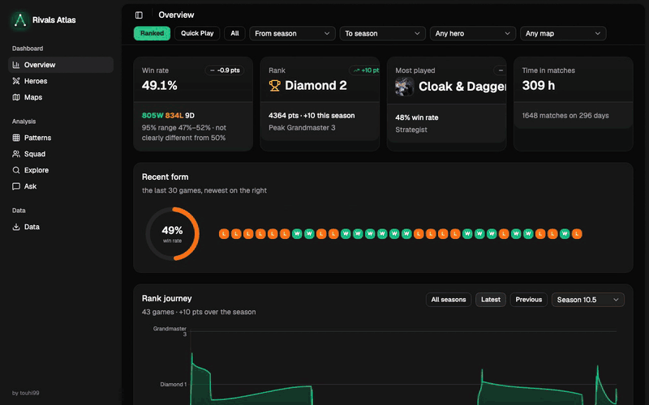
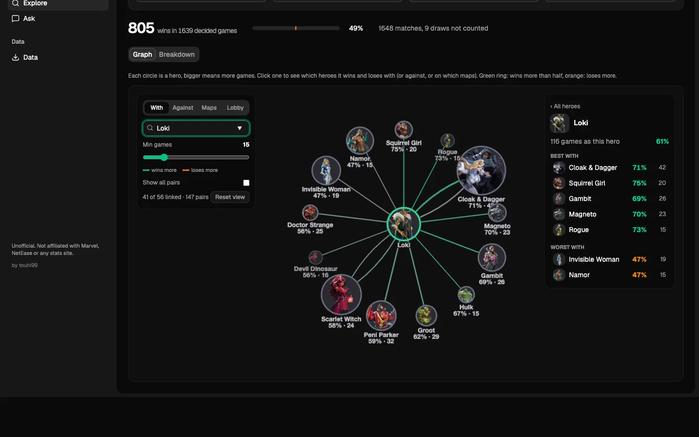
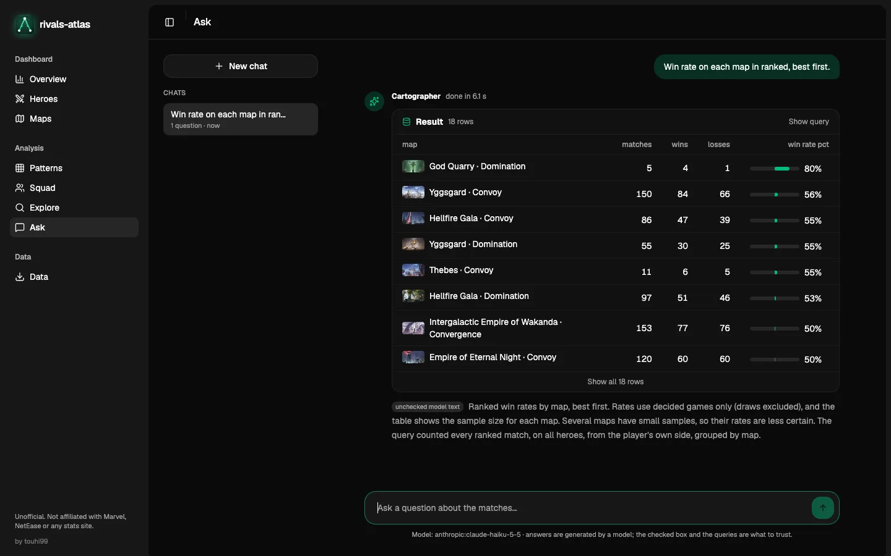
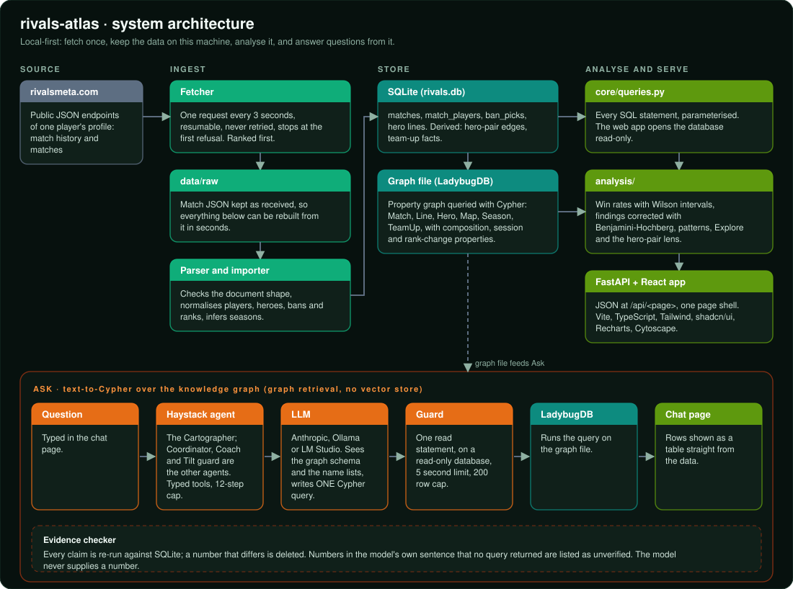

# Rivals Atlas

A hobby project for analysing a player's Marvel Rivals matches. It fetches match history from rivalsmeta.com, shows it in a dashboard with statistics and hero graphs, and answers questions through a knowledge-graph agent.

<p align="center"></p>

<table>
  <tr>
    <td></td>
    <td></td>
  </tr>
</table>

## Pages

- **Overview**: rank journey by season, win rate, recent form, role split
- **Heroes**: win rate per hero next to the site's meta numbers
- **Maps**: win rate by map, hero by map grid
- **Patterns**: results by weekday, hour and session, activity calendar
- **Squad**: regular teammates and party combinations
- **Explore**: filter by map, role, bans, time of day or party; result as a hero graph or breakdown
- **Agents**: **Ask** is a chat with the knowledge-graph agent, with every number backed by a query that can be opened. **Insights** lists findings of the Coach, Tilt guard, Squad synergy and Matchup advisor agents next to the numbers they rest on.
- **Data**: stored data and match fetching

How it fits together: [docs/how-it-works.md](docs/how-it-works.md).



## Install

### Windows and macOS without a terminal

Download the zip for the platform from the [latest release](https://github.com/touhi99/rivals-atlas/releases/latest), unzip it and start the launcher inside:

- **Windows**: `RivalsAtlas-windows.zip`, run `Start Rivals Atlas.bat`.
- **macOS**: `RivalsAtlas-macos.zip`, right-click `Start Rivals Atlas.command` and choose **Open** the first time.

The first launch installs missing dependencies and opens the dashboard in the browser. The terminal or console window is the app; closing it stops the app. The macOS bundle includes the OpenSSL 3 libraries the graph engine needs.

### From a terminal

Requires [uv](https://docs.astral.sh/uv/). Node.js 20 or newer is needed to build the front end from source.

```
git clone <repository-url>
cd rivals-atlas
./scripts/setup.sh
uv run rivals-atlas serve          # http://127.0.0.1:8000
```

`--open` opens the browser when the dashboard is ready. If port 8000 is taken, the next free port is used and printed.

## Fetching data

On first start the database is empty. On the **Data** page, paste the address of a player's rivalsmeta.com page (it ends with a number), read the notice, tick the box and press **Fetch**. Later fetches download new matches only, and a stopped fetch resumes.

CLI: `uv run rivals-atlas fetch --profile <id>` (add `--yes` after reading the notice) and `uv run rivals-atlas import` to rebuild the database from the stored files. `import` must not run during a fetch.

All data comes from [rivalsmeta.com](https://rivalsmeta.com) through the endpoints its pages use. The site is free and run by someone else:

- Ranked is the default. Quick play is fetched with **Mode** on the Data page or `--mode 1`.
- The default pace is one request every 3 seconds, so a long history takes hours.
- The tool does not retry and stops at the first refusal.
- Intended use is one's own history, fetched once and then incrementally, not bulk collection of other players' data.
- The site may change or block this at any time. Following its terms of use is the responsibility of the operator.

Credit rivalsmeta.com for the data and link to this repository when the tool or its data is used elsewhere.

## Model for the Agents page

Ask and Insights need an Anthropic API key, or Ollama or LM Studio running locally. The other pages need no model.

```
cp .env.example .env     # set RIVALS_ATLAS_LLM and, for Anthropic, ANTHROPIC_API_KEY
```

- `anthropic:claude-haiku-5-5`: Claude through the Anthropic API
- `ollama:<model>`: a model from the [Ollama library](https://ollama.com/library)
- `lmstudio:<model>`: a model loaded in [LM Studio](https://lmstudio.ai)

The model writes one read-only query. The rows shown come from the data, and the model's own sentence is marked unchecked. Insights run the model only on **Run now**, which uses tokens; with Anthropic the query results are sent to the API.

## Data

Stored in `./data` (`RIVALS_ATLAS_DATA` changes the location): match files in `data/raw/`, the database `rivals.db` and the graph `graph.lbdb`. `rivals-atlas import` rebuilds the database and graph from the raw files.

## Development

```
uv run ruff check src
uv run mypy src
```

## License

MIT, see [LICENSE](LICENSE). Not affiliated with Marvel, NetEase or rivalsmeta.com.
