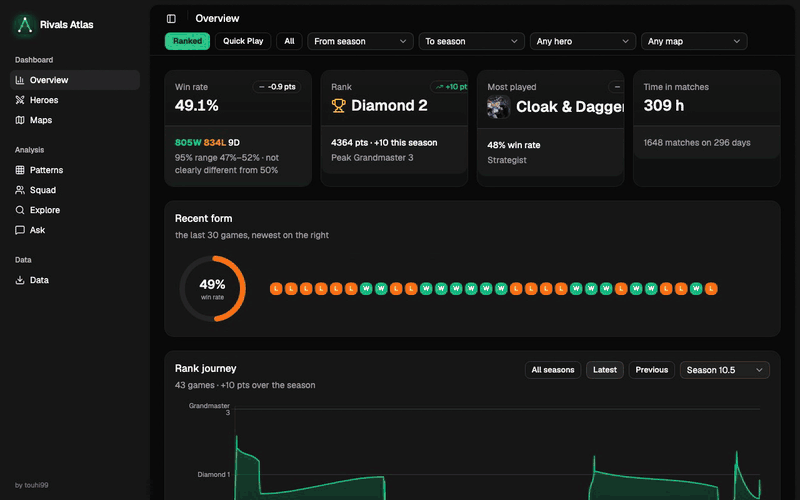
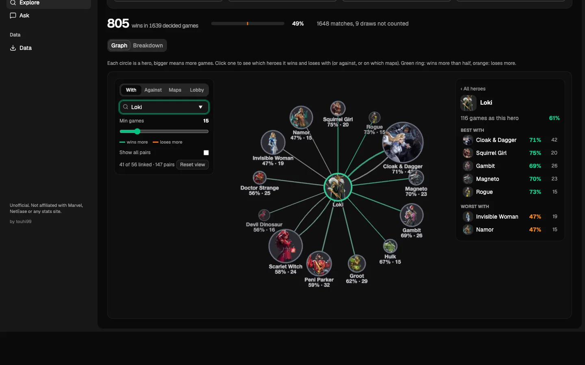
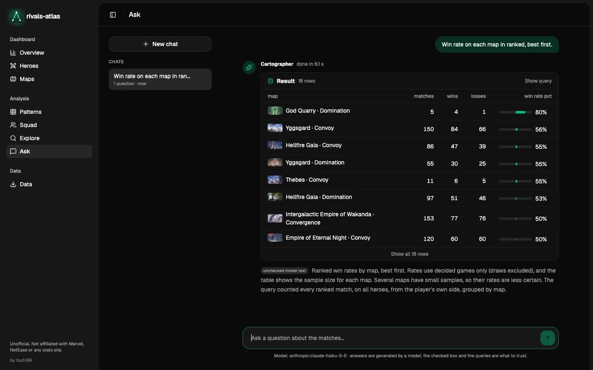
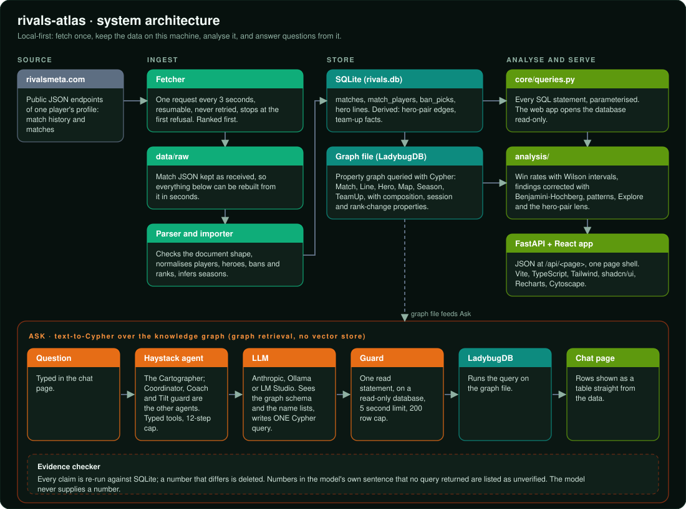

# Rivals Atlas

A personal hobby project for analysing your own Marvel Rivals matches. It fetches your match history from rivalsmeta.com, shows it in a
dashboard, lets you explore with statistics, hero graphs, and lets you analyse complex insights with a knowledge-graph agent about it.

<p align="center"></p>

<table>
  <tr>
    <td></td>
    <td></td>
  </tr>
</table>

| Page | Content |
|---|---|
| **Overview** | Rank journey by season, win rate, recent form, role split and highlights |
| **Heroes** | Win rate per hero next to the site's meta numbers, and your averages next to everyone else's on the same hero |
| **Maps** | Win rate by map, and a hero by map grid |
| **Patterns** | Results by weekday, hour and session, with an activity calendar |
| **Squad** | Your regular teammates and how each party combination did |
| **Explore** | Filter by map, role, bans, time of day or party, and see the result as a hero graph or a breakdown |
| **Ask** | A chat with the knowledge-graph agent; every number comes from a query you can open and check |
| **Data** | What is stored, and fetching match history |

## How it fits together



More detail: [docs/how-it-works.md](docs/how-it-works.md).

## Quick start

Needs [uv](https://docs.astral.sh/uv/) and [Node.js](https://nodejs.org/) 20 or newer. On macOS the graph engine also needs
`brew install openssl@3`. Windows and Linux are untested; an issue is welcome if something fails.

```
git clone <this repository>
cd rivals-atlas
./scripts/setup.sh                 # installs the Python side and the front end, and builds the web app
uv run rivals-atlas serve          # http://127.0.0.1:8000
```

On the first start there is no data. Open **Data**, paste the address of a player's page on rivalsmeta.com (it ends with a
number), read the notice, tick the box and press **Fetch**. Later fetches download only new matches, and a stopped fetch resumes.

From a terminal: `uv run rivals-atlas fetch --profile <id>` (then `--yes` after reading the notice), and `uv run rivals-atlas import`
to rebuild the database from the stored files. Never run `import` while a fetch is running.

## Be gentle with the data source

All match data comes from [rivalsmeta.com](https://rivalsmeta.com), through the endpoints its own pages use. It is a free site run
by someone else, so please treat it kindly:

- **Ranked is the default.** Fetch quick play only if you want it (**Mode** on the Data page, or `--mode 1`).
- **The default pace is one request every 3 seconds.** A long history takes hours, so leave it running.
- The tool never retries and stops at the first refusal.
- Fetch your own history, once, and then only what is new. Do not use this to collect other people's data in bulk.
- The site may change or block this at any time. Following its terms of use is the responsibility of whoever runs the tool.

If this tool or its data is used in another project, article or video, please credit rivalsmeta.com for the data and link to this repository, https://github.com/touhi99/rivals-atlas, for the tool.

## The Ask page needs a model

Ask needs an Anthropic API key, or Ollama or LM Studio running locally.

```
cp .env.example .env     # then set RIVALS_ATLAS_LLM and, for Anthropic, ANTHROPIC_API_KEY
```

| `RIVALS_ATLAS_LLM` | Model |
|---|---|
| `anthropic:claude-haiku-5-5` | Claude through the Anthropic API |
| `ollama:<model>` | Any model from the [Ollama library](https://ollama.com/library) |
| `lmstudio:<model>` | Any model loaded in [LM Studio](https://lmstudio.ai) |

The model only writes one read-only query. The rows shown come straight from the data, and the model's own sentence is marked unchecked.

## Data

Everything is stored in `./data` (change the place with `RIVALS_ATLAS_DATA`): the downloaded match files in `data/raw/`, the database
`rivals.db` and the graph file `graph.lbdb`. Delete the folder to start over, or run `rivals-atlas import` to rebuild the database and
graph from the raw files.

## Development

```
uv run ruff check src
uv run mypy src
```

## Future work

- More default stats
- Streaming answer
- Hero profile / general stats from patch note or official stat note
- A small test suite for the win-rate maths, the importer and the read-only guards

## License

MIT, see [LICENSE](LICENSE).

Not affiliated with Marvel, NetEase or rivalsmeta.com.
