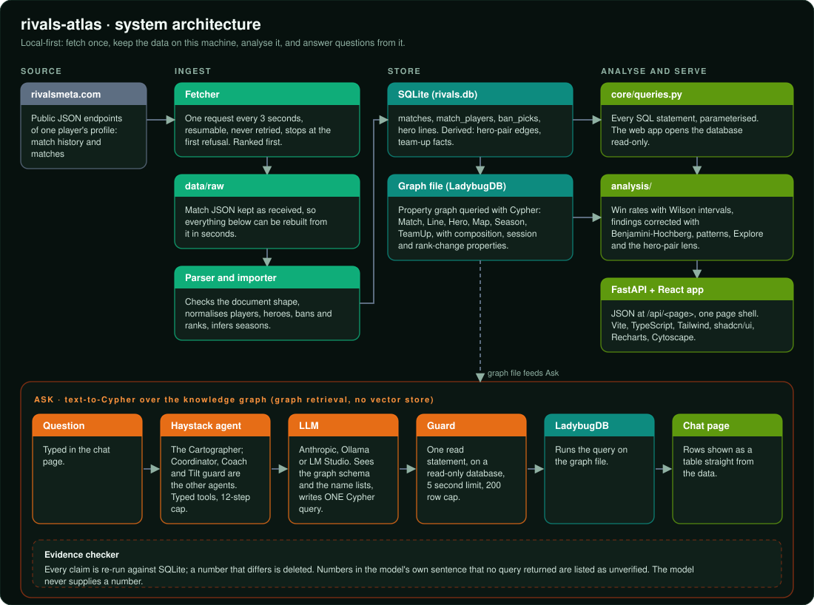

# How it works

Three flows share one local data folder (`data/`): **ingest** brings the match history in, **serve** turns it into pages, **ask** answers
free-form questions from it.

## 1. Ingest: from the site to a database

| Step | What happens | Code |
|---|---|---|
| Fetch | One player's history and matches are read from rivalsmeta.com, one request every 3 seconds, resumable, never retried | `ingest/fetch.py` |
| Keep | Every document is stored untouched under `data/raw/`, so the database can be rebuilt from it in seconds with `rivals-atlas import` | `data/raw/` |
| Import | Documents are checked for the expected shape, then written to SQLite; seasons the history list did not cover are inferred | `ingest/importer.py` |
| Derive | Hero-pair edges and team-up facts are computed; the graph file (LadybugDB) is rebuilt | `graph/` |

## 2. Serve: from the database to a page

| Layer | Role | Code |
|---|---|---|
| Queries | Every SQL statement, parameterised; the web app opens the database read-only | `core/queries.py` |
| Analysis | Win rates with Wilson intervals, findings corrected with Benjamini-Hochberg, patterns, Explore, the hero-pair lens | `analysis/`, `graph/network.py` |
| Payloads | One function per page shapes the data as JSON | `web/payloads.py` |
| API | FastAPI routes, `GET /api/<page>`, and the one HTML shell | `web/api.py` |
| App | React single-page app: Vite, TypeScript, Tailwind, shadcn/ui, Recharts, Cytoscape | `frontend/` |

## 3. Ask: from a question to a checked answer

This is text-to-Cypher over a knowledge graph: graph retrieval without a vector store.

| Step | What happens | Code |
|---|---|---|
| Agent | A Haystack agent (the Cartographer; Coordinator, Coach and Tilt guard are the others) with typed tools and a 12-step cap | `agents/` |
| Prompt | The model gets the graph schema and the hero, map and mode names, from plain text files | `prompts/` |
| Query | The model writes **one** Cypher query; Anthropic, Ollama or LM Studio can be the model | `agents/llm.py` |
| Guard | A single read statement, on a read-only database, with a 5 second limit and a 200 row cap | `graph/store.py` |
| Answer | The rows are shown as a table straight from the data; the model's sentence is labelled unchecked | `web/ask.py` |
| Check | Every claim is re-run; a number that differs is deleted; numbers no query returned are listed as unverified | `agents/evidence.py` |

## Folders

| Folder | Holds |
|---|---|
| `core/` | configuration, table definitions, filters, `queries.py` |
| `ingest/` | fetch, parse, import, hero meta |
| `analysis/` | statistics, patterns, findings, Explore |
| `graph/` | hero pairs, the graph file, team-up facts |
| `agents/` | tools, evidence check, model agents |
| `web/` | `api.py` routes, `payloads.py` page data, `ask.py` job runner |
| `prompts/` | model instructions as text files |
| `frontend/` | the React app, built into `web/ui/` (not stored in git) |

Rates are over decided games (draws left out), carry a 95% interval, and colour appears only when the whole interval is on one side of
50%.
